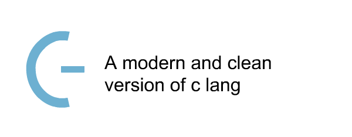
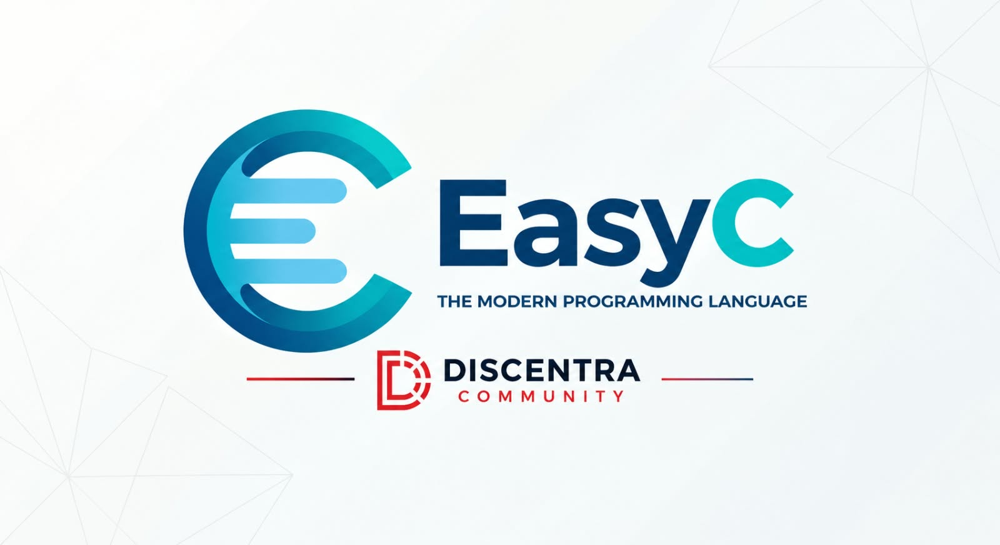

# Bagron

  

  <b>Bagron es un lenguaje de programación moderno, limpio y estáticamente tipado, compilado directamente a LLVM IR.</b>

  
  
  
  

---

## ¿Qué es Bagron?

**Bagron** combina la elegancia sintáctica, la orientación a objetos y la legibilidad de lenguajes de alto nivel con la velocidad, el control de bajo nivel y el alto rendimiento.

En lugar de depender de una máquina virtual pesada o de un runtime complejo con recolección de basura, el compilador de **Bagron** procesa el código fuente, valida tipos y ámbitos estáticamente y emite **LLVM IR** directamente. No existe ningún paso intermedio que genere código intermedio superfluo: LLVM se encarga de la optimización y la generación de código nativo para la arquitectura de destino.

---

## Características Principales

* **Compilación directa a LLVM IR:** El compilador emite LLVM IR mediante `llvmlite` para su verificación y futura generación de código nativo.

* **Punto de entrada obligatorio:** Cada módulo ejecutable debe declarar `func main() int:`; su expresión entera de retorno se usa como código de salida y los métodos de clase no cuentan como entrypoint.

* **Sintaxis Minimalista e Intuitiva:** Basada en indentación limpia (`.bg`), sin puntos y coma obligatorios ni sobrecarga de paréntesis innecesarios.

* **Validación semántica:** El frontend registra y valida tipos, variables y scopes antes de emitir LLVM IR.

* **Constantes explícitas:** `const tipo` expresa un valor constante; los punteros separan la constancia del puntero y del valor apuntado.

* **Memoria explícita:** `$valor` obtiene una dirección, `(p)` la
  desreferencia y `((pp))` permite varios niveles. `&` conserva el AND
  bitwise; los arrays se indexan con GEP LLVM y los punteros nulos se atrapan
  en tiempo de ejecución. Las operaciones sobre procedencia desconocida y
  los índices dinámicos requieren `@unsafe`; `@assembler` ya implica ese
  decorador.

* **Estructuras, Enumeraciones y Clases:**
  * `struct`, `mold` y `flags`: Tipos nominales validados y emitidos como tipos agregados LLVM.
  * `enum`: Enumeraciones con base entera `int32` por defecto o un tipo entero explícito, además de valores implícitos/explícitos.
  * `class`: Tipos orientados a objetos con ciclo de vida RAII (`__init__`, `@method`, `destroy`).

* **Modulos y dependencias nativas:** `import` carga archivos `.bg`; `include
  "header" link "library"` resuelve headers y bibliotecas del sistema para el
  enlace LLVM.

* **Control de Flujo Expresivo:**
  * Condicionales: `if`, `elif`, `else`, `not`.
  * Bucles condicionales: `while condicion:`.
  * Iteración numérica tipada: `for i: int8 ran (1, 100, 1):`.

* **Toolchain Integrada:** Compilador, analizador sintáctico y herramientas para el flujo de trabajo de desarrollo.

---

## Requisitos / Requirements

* **Python:** 3.14 o superior.
* **llvmlite:** 0.50.0, gestionado mediante vnma.
* **LLVM/Clang/LLD:** La compilación genera y verifica `.ll`, produce `.obj` y enlaza un `.exe` para el entrypoint mínimo `main`.

---

## Herramientas

El compilador se apoya en dos herramientas del mismo ecosistema:

* **[Gram](https://github.com/GrandKenzy/Gram):** motor de parseo del frontend. Define las reglas gramaticales BNF combinatorias del lenguaje (`core/frontend/syntax/`). Se instala con vnma.
* **[vnma](https://github.com/GrandKenzy/vnma) (Vendor Manager):** gestor de dependencias y empaquetado para proyectos Python. Descarga, construye y extrae wheels compatibles con la plataforma directamente en el proyecto, con aislamiento de rutas en tiempo de ejecución y compatibilidad con binarios nativos.
  * Instala desde PyPI, rutas locales (monorepos) y repositorios Git.
  * Genera un `vnma.lock` determinista con versiones, orígenes y metadatos binarios, para builds reproducibles.
  * Instalación: `pip install vnma`.

---

## Instalación y Uso Rápido

* NOTA: La instalación, uso rápido y ejemplos está en discusión.

## Documentación

* NOTA: Por definir

---

## Licencia

Este proyecto está bajo la Licencia MIT. Consulta el archivo de licencia para más detalles.

  

